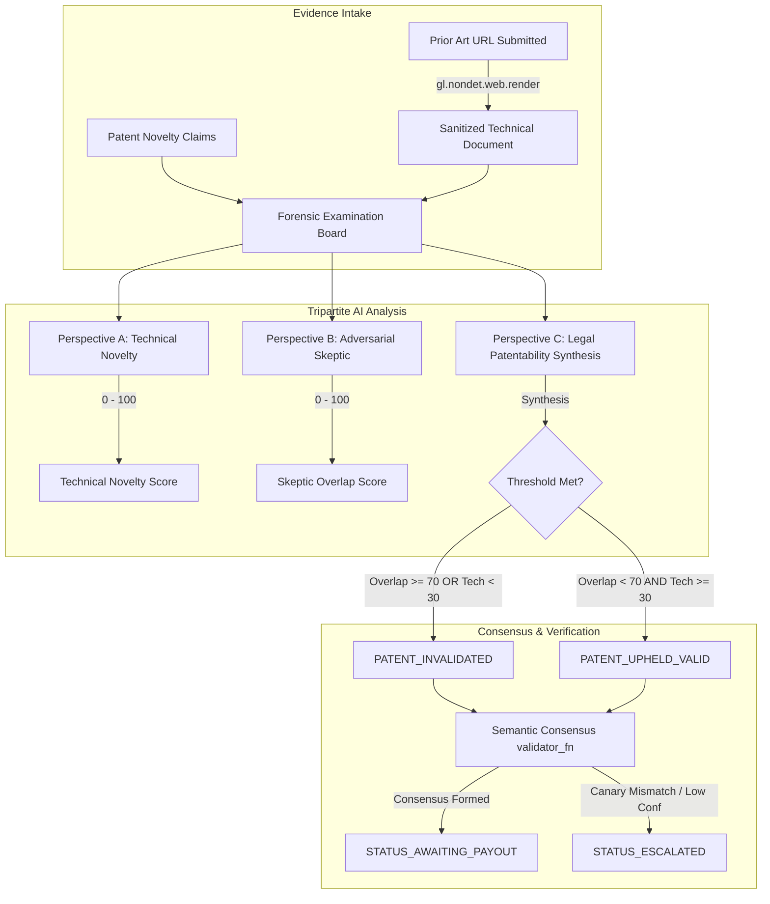
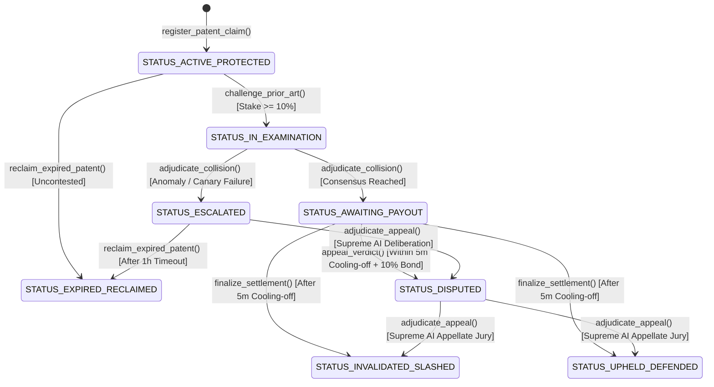
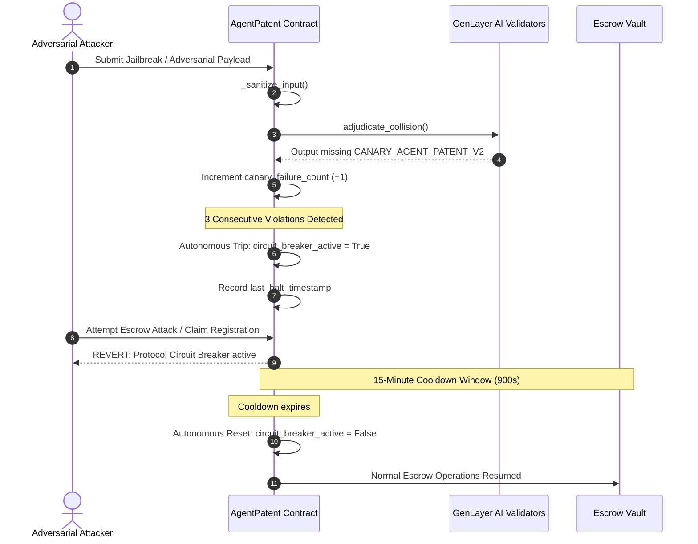

# 🏛️ AgentPatent — Architecture Specification

> **Autonomous AI Research Prior Art & Patent Collision Court**  
> *Target Network:* GenLayer Studionet (Chain ID: `61999` / `0xF22F`)  
> *Consensus Protocol:* Decentralized Subjective Consensus via Optimistic Democracy

---

## 1. System Overview

AgentPatent is an on-chain autonomous judicial protocol designed for the **Agentic Economy** and decentralized science (**DeSci**). As autonomous AI researchers, self-driving laboratories, and algorithm engineers rapidly synthesize novel formulations, existing patent offices (USPTO, EPO) create multi-year bottlenecks.

AgentPatent establishes an autonomous, decentralized prior art collision court powered by GenLayer's multi-validator subjective consensus. It executes programmatic escrow bonds, crawls public prior art evidence on the live web without off-chain oracles, applies multi-perspective AI scrutiny, and provides a timelocked appellate court with autonomous circuit breaker protections.

---

## 2. Tripartite Multi-Perspective AI Deliberation

Unlike traditional contracts that execute naive string comparison or single-prompt LLM evaluation, AgentPatent v2.0 implements a **Tripartite Multi-Perspective Forensic Examination**:

---

## 3. Protocol State Machine

The contract transitions autonomously through 8 discrete states without central administrator intervention:

---

## 4. Autonomous Circuit Breaker Architecture

In accordance with GenLayer's **Autonomous Protocols** guidelines (systems that run and defend themselves without multisig governance):

---

## 5. Technical Specifications

| Parameter | Value | Rationale |
| :--- | :--- | :--- |
| **Cooling-Off Window** | 300 seconds (5 min) | Dispute grace period preventing atomic flash-loan extraction |
| **Circuit Breaker Window** | 900 seconds (15 min) | Autonomous self-healing cooldown without centralized key |
| **Canary Failure Threshold** | 3 consecutive failures | Protects escrow against coordinated LLM jailbreak probes |
| **Challenge Bond** | ≥ 10% of validity escrow | Anti-spam and griefing deterrent for challengers |
| **Appeal Bond** | ≥ 10% of validity escrow | Deterrent against frivolous post-verdict appeals |
| **Storage Generic** | `TreeMap[str, PatentCase]` | Sized integer and string key storage compliant with GenVM |
